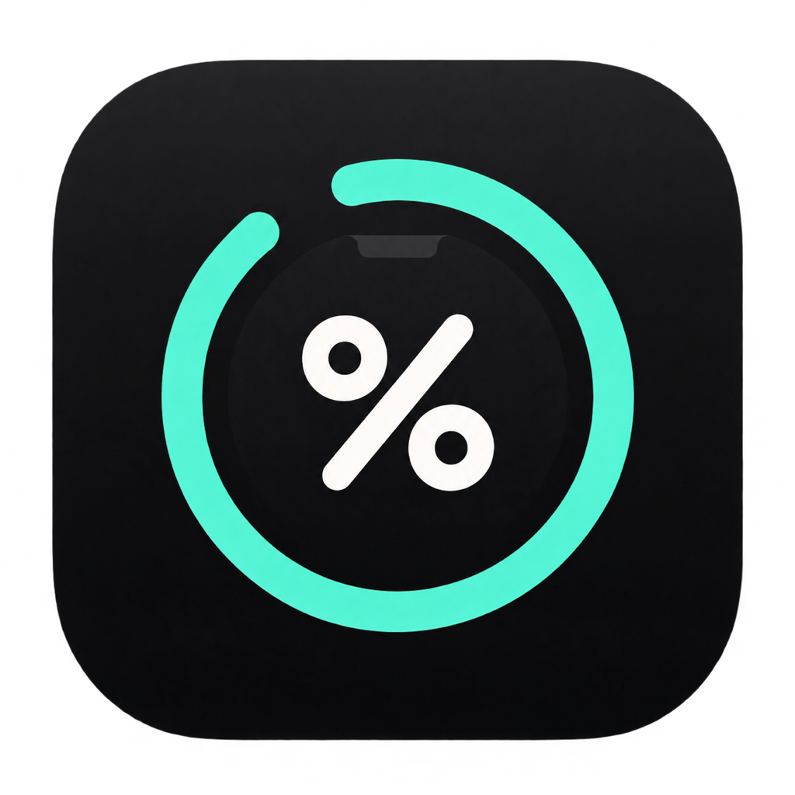

<p align="center">
  
</p>

# Codex Reset

Sua franquia do Codex sempre à vista. Um monitor nativo para macOS que mostra a porcentagem semanal restante, as conversas ativas e o tempo até a próxima renovação.

## Downloads

<!-- latest-release:start -->
### Versão atual: [0.1.23](https://github.com/Benfic4rthur/codex-reset/releases/tag/v0.1.23)

Os dois downloads abaixo são da **versão 0.1.23**. [Ver novidades desta versão](https://github.com/Benfic4rthur/codex-reset/releases/tag/v0.1.23).

| Apple Silicon · M1, M2, M3 e posteriores | Intel · x86_64 |
| :---: | :---: |
| **[⬇ Baixar Apple Silicon · 0.1.23](https://github.com/Benfic4rthur/codex-reset/releases/latest/download/Codex-Reset-Apple-Silicon.dmg)** | **[⬇ Baixar Intel · 0.1.23](https://github.com/Benfic4rthur/codex-reset/releases/latest/download/Codex-Reset-Intel.dmg)** |
| Com notch: visual integrado ao recorte. Sem notch, incluindo M1: cápsula no topo | Cápsula compacta dentro da barra de menus |
<!-- latest-release:end -->

### Depois de instalar: liberar no Terminal

**Após copiar o app para Aplicativos, execute o bloco abaixo no Terminal antes de abrir o Codex Reset.** Esta versão ainda não possui assinatura Developer ID nem notarização da Apple; o macOS pode bloquear a abertura até você autorizar o aplicativo.

O comando encontra o app em **Aplicativos do sistema** ou **Aplicativos do seu usuário** e remove somente a marca de quarentena do Codex Reset:

```sh
if [ -d "/Applications/Codex Reset.app" ]; then
  xattr -dr com.apple.quarantine "/Applications/Codex Reset.app"
elif [ -d "$HOME/Applications/Codex Reset.app" ]; then
  xattr -dr com.apple.quarantine "$HOME/Applications/Codex Reset.app"
else
  echo "Copie primeiro o Codex Reset.app do DMG para a pasta Aplicativos."
fi
```

Depois, abra o **Codex Reset** e o **Codex Desktop**. Repita essa etapa ao instalar uma nova versão baixada. Se aparecer um erro de permissão, confira se você tem permissão para alterar a cópia instalada. Veja também as [orientações da Apple para autorizar aplicativos](https://support.apple.com/102445).

Os links sempre apontam para a versão mais recente. Veja as novidades e os downloads anteriores em [Releases](https://github.com/Benfic4rthur/codex-reset/releases). Cada versão inclui os hashes SHA-256 dos DMGs.

**Requisitos:** macOS 14 ou mais recente e Codex Desktop instalado e autenticado na conta de quem vai usar o monitor. O Codex Desktop precisa ser compatível com o Mac. O monitor é um projeto independente, sem vínculo oficial com a OpenAI.

### Como instalar

1. Baixe o DMG correspondente ao processador do seu Mac.
2. Abra o DMG e arraste **Codex Reset.app** para **Aplicativos**.
3. Execute no Terminal o [comando de liberação acima](#depois-de-instalar-liberar-no-terminal).
4. Abra o Codex Reset uma vez. Ele configura o início automático para seu usuário.
5. Abra o Codex Desktop. O monitor aparece enquanto ele estiver aberto.

Para atualizar, feche o Codex Reset pelo botão de desligar que aparece ao passar o mouse, substitua o aplicativo e abra a nova versão. As atualizações são baixadas manualmente pelo GitHub.

## Como funciona

- **Franquia:** escolha entre o estilo Compacto e Número grande para a porcentagem restante da janela semanal. Atualiza a cada 30 segundos usando uma conexão local reutilizada com o Codex App Server.
- **Atividade:** projeto, modelo e esforço da conversa ativa mais pesada. Sem atividade, aparece apenas a franquia. A seta aparece quando há mais de uma conversa ativa. A lista atualiza a cada 5 segundos. O nome do projeto considera a associação salva no Codex, incluindo conversas executadas em cópias de trabalho (worktrees) fora da pasta principal. Quando necessário, identifica a origem da cópia pelos metadados do Git.
- **Renovação semanal:** ao passar o mouse, aparece uma contagem regressiva até a renovação informada pela conta. Mostra dias e horas (por exemplo, `6d 18h`); quando falta menos de um dia, mostra horas e minutos (por exemplo, `18h 30m`). A tela atualiza a cada minuto.
- **Reset extra:** janela histórica baseada somente nos resets dos últimos **30 dias** de [codex-resets.com](https://codex-resets.com/), com datas estimadas de início e fim ancoradas no último reset observado. A faixa aparece em linguagem direta, como “Entre 1d 14h e 3d 19h”, com a indicação “Estimativa histórica”. Abaixo de um dia, usa horas e minutos. Dentro da janela, mostra “Dentro da janela” e o tempo estimado restante; a tela atualiza a cada minuto. O histórico é consultado ao abrir o aplicativo e depois a cada **duas horas**. O botão de atualizar nos detalhes, alinhado abaixo do indicador de porcentagem, consulta a fonte imediatamente, sem fechar o app. Durante a consulta, mostra um indicador de carregamento e bloqueia novos cliques; se falhar, permite tentar novamente. A partir de seis intervalos válidos, permite estimativa; entre seis e onze, mostra “Estimativa · poucos dados”. Abaixo de seis, informa histórico insuficiente, sem recorrer a dados mais antigos. A contagem a cada minuto é local, sem nova consulta ao site; consultar os mesmos dados não reinicia o prazo. Quando a janela termina, aparece “Janela encerrada”, aguardando novos dados. Quando um anúncio vence e a conta já renovou a franquia, o app encerra o aviso antigo, consulta a fonte e recalcula a próxima janela a partir do reset observado, usando os mesmos intervalos históricos do site. A confirmação usa a mudança da franquia ou o início do novo ciclo semanal perto do horário anunciado; uma porcentagem alta sozinha não confirma reset. O início do ciclo também permite reconhecer a renovação ao reabrir o app. Consultar os mesmos dados não restaura o anúncio nem reinicia a contagem. Não representa uma promessa nem um aviso antecipado da OpenAI.

Nos MacBooks Intel e nos M1 sem notch, a cápsula compacta fica centralizada e inteira dentro da altura da barra de menus. A porcentagem aparece em texto grande, com uma barra horizontal de progresso separada; não há círculo em volta do número. Com atividade, projeto, modelo e esforço aparecem em uma linha legível. A altura ocupa a barra real da tela, deixando apenas uma pequena margem para manter o contorno arredondado visível. Ela ocupa apenas o espaço da franquia quando não há atividade e cresce na horizontal quando há conversas. Os detalhes se abrem ao encostar o mouse em qualquer parte da faixa do monitor, incluindo a porcentagem, a atividade e o centro da câmera. A detecção cobre toda a altura física do notch, mesmo com a barra visual reduzida nas configurações, e tem uma pequena tolerância nas laterais. A abertura não exige permanecer parado sobre o painel; ao sair, há uma breve tolerância para alcançar os controles. Essa área de ativação não aumenta o desenho nem captura cliques nos aplicativos vizinhos. Nos Macs com notch, o visual continua integrado ao recorte; a lateral de projeto, modelo e esforço ajusta a largura ao conteúdo e só reserva espaço para a seta quando ela aparece. O aplicativo detecta o tipo de tela automaticamente. A altura é medida pela área que o macOS reserva no topo da tela, com `NSScreen.frame` e [`NSScreen.visibleFrame`](https://developer.apple.com/documentation/appkit/nsscreen/visibleframe); se a barra estiver oculta, usa `NSStatusBar.system.thickness`. A medida é conferida novamente enquanto o app está aberto. Não depende de uma altura fixa atribuída ao MacBook Pro 2019, ao M1 Air ou a uma arquitetura.

## Idioma

Nas configurações, escolha **Português**, **English** ou **Español**. A troca vale imediatamente para o notch, os detalhes, os avisos e previsões de reset, as dicas e toda a janela de configurações. O idioma fica salvo neste Mac e não altera a disposição dos campos. Nomes de projetos, conversas e modelos permanecem como foram definidos.

## Estilo da franquia

Nas configurações, escolha **Compacto** para manter a apresentação atual ou **Número grande** para destacar a porcentagem. Nos Macs com notch, o novo estilo usa um número maior com uma barra de progresso fina abaixo. Em telas sem notch, mantém número e barra lado a lado dentro da barra de menus.

Ao abrir o painel com o mouse, a porcentagem cresce um pouco quando há espaço. O tamanho é calculado com a altura disponível e as medidas reais da fonte, incluindo `100%`, mantendo a câmera e o indicador ancorados e o topo dentro da barra de menus. A escolha fica salva neste Mac e é preservada ao restaurar a disposição padrão dos campos.

## Monte o seu painel

Abra a **engrenagem à direita**, alinhada com o botão de atualizar. A janela de configurações mostra uma tela de Mac, com o conjunto preto centralizado e as áreas esquerda, câmera e direita identificadas. O botão **Editor anterior** permite comparar com a disposição compacta. A janela acomoda o conteúdo sem rolagem interna; em telas menores, usa abas para as medidas e opções. Os campos para arrastar incluem: conversa, projeto, tokens por segundo, modelo/agente, esforço, número de conversas ativas, franquia e resets.

- Arraste para as **duas linhas da direita** ou as **três linhas do painel aberto**. Arraste novamente para mudar a ordem e use **×** para remover. O menu **+** permite adicionar sem arrastar.
- Por exemplo: **conversa + tokens/s** na primeira linha e **modelo + esforço** na segunda. Também pode esvaziar a direita e manter somente a porcentagem à esquerda.
- Cada linha de baixo divide o espaço igualmente entre os campos, com cada um centralizado na sua coluna. As linhas são independentes: pode mostrar só o reset extra, só o semanal, tokens, ou a combinação que preferir. Os campos do topo ficam em uma linha em telas sem notch para respeitar a altura da barra de menus.
- **Total processado/s** soma entrada e saída, incluindo o contexto reutilizado do cache. **Saída/s** mostra somente os tokens de saída, incluindo raciocínio. São médias entre as últimas atualizações registradas pelo Codex, consultadas localmente a cada cinco segundos; não medem velocidade instantânea nem franquia debitada. O cache já faz parte da entrada e não é contado duas vezes. Sem duas amostras recentes da mesma execução, mostram um traço. A ajuda informa o horário e os componentes da amostra.
- O agente principal continua sendo o de maior esforço entre as conversas ativas. A lista de outras conversas e o nome curto do modelo são opcionais. O nome curto remove somente `GPT-`, mantendo a família: `GPT-6.1 Sol` vira `6.1 Sol`; `GPT-6 Astra` vira `6 Astra`. Desative a opção para voltar ao nome completo.
- Use os controles de tamanho ou **Ctrl + Option + arrastar** no monitor. Na barra, ajusta a área da direita e a altura do topo; no painel aberto, ajusta a largura e o espaço extra dos detalhes. O recorte da câmera permanece ancorado e o topo respeita a altura disponível no macOS. **Ajustar automaticamente** restaura as medidas automáticas.
- A janela aparece no Dock enquanto estiver aberta. **Ocultar na barra de menus** e o botão vermelho fecham somente as configurações; o monitor continua funcionando. Reabra pela engrenagem.

### Anúncio do Tibo

Arraste **Anúncio do Tibo** para uma linha. Aparece uma foto discreta com o ícone do X; ao clicar na foto, abre o último anúncio de reset de @thsottiaux registrado em codex-resets.com, com horário, texto no idioma escolhido e acesso ao original. Passar o mouse pela foto mantém o painel aberto, mas não abre o cartão; o anúncio exige um clique na foto. Não representa todos os posts do perfil. Também aceita os registros de reset observado publicados pela fonte, mesmo sem campo de autor, validando o link da conta do Tibo no X. Quando o site fornece um resumo, o cartão o identifica como **Resumo do último reset**, com **Referência no X**; quando há o texto da postagem, apresenta o anúncio. Entre representações do mesmo link, prioriza o texto da postagem. Os links aparecem em uma fileira compacta de botões **Link 1**, **Link 2** e **Anúncio original**, abrindo no navegador.

A tradução usa o recurso do macOS 15 ou posterior. Em português ou espanhol, o sistema pode baixar os idiomas necessários na primeira utilização. Em inglês, mostra o original sem tradução. Não utiliza a franquia do Codex nem uma chave de API. Nas versões anteriores do macOS, mostra o original e seus links. Texto traduzido e métricas de tokens ficam somente em memória. O cache da tradução considera o idioma e a revisão do texto, para que uma atualização da mesma postagem também seja traduzida novamente.

### Último reset

O painel mostra **Último reset · há 5h**, com data e horário na ajuda ao passar o mouse. Quando a conta renova a franquia, um ponto verde indica que você ainda não viu a atualização. Nas três primeiras aberturas do painel, aparece **Novo reset**. O aviso continua pendente após reiniciar o app; não desaparece só porque o reset aconteceu de madrugada. Pode desativar o destaque ou remover o campo do layout.

As preferências, as medidas e o horário do último reset ficam salvos somente neste Mac. Os dados de franquia e das conversas não são enviados ao site.

## Privacidade

**Cada instalação usa a conta local de quem instalou o app.** Os DMGs contêm somente o aplicativo, seu ícone e as instruções de instalação.

- Nenhuma chave de API, senha, sessão, conversa ou configuração do desenvolvedor é incluída nos downloads.
- O monitor consulta a franquia pelo Codex instalado no próprio Mac. Não exige uma chave de API separada.
- A lista de conversas usa apenas metadados do histórico local, em modo de leitura. O app não lê o conteúdo das mensagens.
- Não há servidor próprio, telemetria nem envio das conversas para o repositório.

Detalhes sobre os arquivos consultados e as conexões estão em [Privacidade](PRIVACY.md).

## Compilar localmente

Para desenvolvimento, use Xcode ou Xcode Command Line Tools com Swift 5.10 ou mais recente:

```sh
./scripts/build-app.sh
./scripts/install-companion.sh
```

A instalação pelo script usa `~/Applications/Codex Reset.app`. O DMG também permite instalar nessa pasta; ao atualizar, substitua a cópia que já utiliza para evitar duas instalações.

Para compilar uma arquitetura específica:

```sh
./scripts/build-app.sh --arch arm64
./scripts/build-app.sh --arch x86_64
```

## Publicar uma nova versão

A publicação acontece no Mac do desenvolvedor, usando o GitHub CLI autenticado. **Este projeto não usa GitHub Actions nem CI.**

1. Incremente `CFBundleShortVersionString` e `CFBundleVersion` em `Info.plist`.
2. Escreva as novidades em `releases/vVERSAO.md`.
3. Revise os arquivos e faça o commit das mudanças.
4. Execute:

```sh
./scripts/publish-release.sh
```

O comando compila as duas arquiteturas, monta e confere os DMGs, gera os hashes e publica os arquivos em uma nova Release, marcada como a mais recente. Depois confirma a versão publicada e atualiza automaticamente o número destacado e os botões de download neste README, com um commit enviado ao repositório. Os links de download acima passam a apontar para ela automaticamente. O histórico de versões permanece disponível.

Para gerar somente os DMGs, sem publicar:

```sh
./scripts/create-dmgs.sh
```

Os arquivos locais são gerados em `.build/releases/VERSAO/` e nunca entram no Git. Depois de confirmar a publicação, a pasta `.build/` pode ser removida para limpar os artefatos de compilação.
